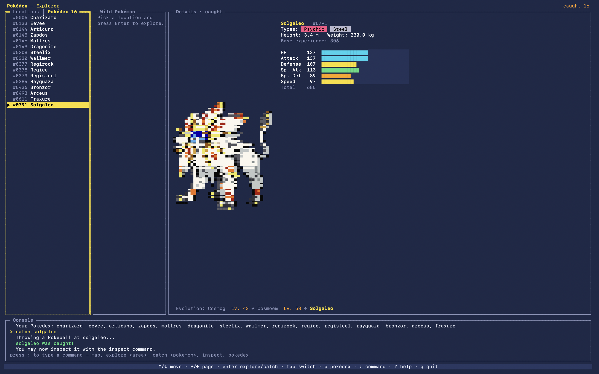
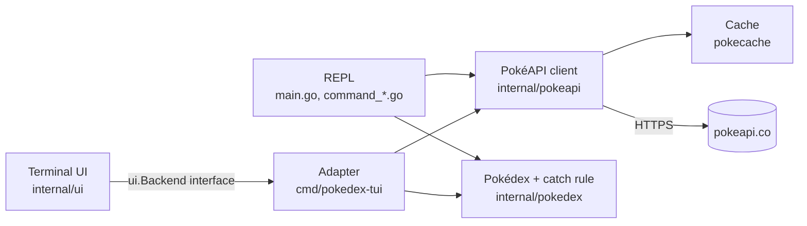

# pokedex_cli

A Pokédex for the terminal, written in Go. Explore locations from the Pokémon games, find the wild Pokémon living there, try to catch them, and inspect the ones you've caught, all with live data from [PokéAPI](https://pokeapi.co).

It comes in two forms that share the same backend:

- **A REPL**: type commands like `explore canalave-city-area` and `catch magikarp` at a prompt.
- **A full-screen terminal UI** built with [Bubble Tea](https://github.com/charmbracelet/bubbletea): browse areas with the arrow keys, watch the Pokéball wobble, and see pixel-art sprites, colour-coded stats and evolution lines.

<!-- Add a screenshot of the UI here, e.g.  -->

## Features

- **Location browsing**: page through every location area in the games (`map` / `mapb`)
- **Exploring**: list the wild Pokémon found in an area
- **Catching**: the higher a Pokémon's base experience, the harder it is to catch (5–95% chance)
- **Pokédex**: inspect stats, types, height and weight of everything you've caught
- **Pixel-art sprites** drawn in the terminal with half-block characters; Pokémon you haven't caught show as a silhouette
- **Evolution lines** with how each stage evolves (`Lv. 16`, `Water Stone`, `Trade`, `Friendship`…), including branching lines like Eevee's
- **Saved Pokédex**: catches are saved to `~/.pokedex.json` after every catch, so they survive a restart, and the REPL and the UI share one Pokédex
- **Response cache** with automatic expiry, so repeated requests are instant and PokéAPI isn't hit twice

## Getting started

Requires **Go 1.27+** and a terminal with true-colour support (iTerm2, Ghostty, WezTerm, or recent macOS Terminal).

```bash
git clone https://github.com/arifidris1103/pokedex_cli.git
cd pokedex_cli
go mod tidy
```

### REPL

```bash
go run .
```

```
> map
Location areas:
 - canalave-city-area
 - eterna-city-area
 ...
> explore canalave-city-area
Exploring canalave-city-area...
Found Pokemon:
 - tentacool
 - magikarp
 ...
> catch magikarp
Throwing a Pokeball at magikarp...
magikarp was caught!
You may now inspect it with the inspect command.
> inspect magikarp
Name: magikarp
Height: 9
Weight: 100
...
```

| Command | What it does |
| --- | --- |
| `map` / `mapb` | next / previous page of location areas |
| `explore <area>` | list the Pokémon found in an area |
| `catch <pokemon>` | throw a Pokéball |
| `inspect <pokemon>` | show a caught Pokémon's stats and types |
| `pokedex` | list everything you've caught |
| `help` / `exit` | show commands / quit |

### Terminal UI

```bash
go run ./cmd/pokedex-tui        # live data from PokéAPI
go run ./cmd/pokedex-tui-demo   # offline demo data, no network needed
```

The window needs to be at least 90×24.

Your Pokédex is saved in `~/.pokedex.json`. Set `POKEDEX_FILE` to keep it somewhere else, or delete the file to start over.

| Key | Action |
| --- | --- |
| `↑` `↓` | move through a list |
| `←` `→` | previous / next page of areas |
| `Enter` | explore the selected area · catch the selected Pokémon |
| `c` | catch the selected Pokémon |
| `Tab` | switch between the locations and wild Pokémon lists |
| `p` / `1` | Pokédex tab / Locations tab |
| `:` | type any REPL command, e.g. `catch pikachu` |
| `?` | help |
| `q` | quit |

To install it as a command you can run from anywhere:

```bash
go install ./cmd/pokedex-tui
pokedex-tui   # needs $(go env GOPATH)/bin on your PATH
```

## How it's built



```
main.go, repl.go, command_*.go   the REPL: one file per command
pokecache/                       thread-safe byte cache with a background reap loop
internal/pokeapi/                PokéAPI client and response types
internal/pokedex/                caught Pokémon and the catch rule
internal/ui/                     Bubble Tea UI
cmd/pokedex-tui/                 connects the real backend to the UI
cmd/pokedex-tui-demo/            runs the UI on an offline demo backend
```

### Design notes

- **One generic request helper.** Every API call goes through `get[T any](c *Client, url string) (T, error)`, which checks the cache, fetches, checks the status code and decodes the JSON. Each endpoint method is then a single line, e.g. `return get[Pokemon](c, baseURL+"/pokemon/"+name)`.
- **The UI only knows an interface.** `internal/ui` never imports the API client. It talks to a `ui.Backend` interface whose methods mirror the REPL commands, and a small adapter in `cmd/pokedex-tui` implements it. That's why the UI can also run on an offline demo backend, and why its tests need no network.
- **Safe for concurrent use.** The UI makes requests from background goroutines so it never freezes, which means the cache and the Pokédex can be used by several goroutines at once. Both guard their maps with a `sync.Mutex`.
- **Recursive types for evolution chains.** PokéAPI returns an evolution chain as a tree of any depth (Eevee has 8 branches). It's decoded into one type that contains a slice of itself (`ChainLink.EvolvesTo []ChainLink`), and a recursive `findPath` keeps only the branch that leads to the selected Pokémon.
- **Only the fields that are used.** The full Pokémon JSON lists every move in every game. The structs keep only the fields the app needs; the decoder skips the rest.
- **Shared rules.** The REPL and the UI use the same `pokedex.Roll` catch rule, so a Pokémon is equally hard to catch in both.
- **Safe saving.** The Pokédex is written to a temporary file that is then renamed over the old one, so a crash mid-save can't corrupt it. Before writing, it merges in what's already on disk, so the REPL and the UI can be open at the same time without erasing each other's catches. A file it can't read is never overwritten.

## Testing

```bash
go test ./...
```

Tests cover input parsing, the cache (including expiry), the request helper (run against a local `httptest` server, checking that cached responses skip the network), the catch rule, the Pokédex (saving, reloading, two programs at once, a corrupt file), evolution-path finding (straight, middle-stage and branching lines), and the UI. The UI tests drive it like a user does: they send key presses, run commands and check that every frame exactly fills the terminal.

## Roadmap

- [x] Save the Pokédex to a file so catches survive a restart
- [ ] An evolution panel with sprites in the UI, and an `evolve` command in the REPL
- [ ] Shiny Pokémon
- [ ] Type matchups (weaknesses and resistances)

## Acknowledgements

- Built following [Boot.dev](https://www.boot.dev)'s *Build a Pokédex* guided project, then extended with the terminal UI, evolution lines and sprites.
- The terminal UI (`internal/ui`) was built with AI assistance (Claude).
- Data and sprites from [PokéAPI](https://pokeapi.co). Pokémon and Pokémon names are trademarks of Nintendo, Creatures Inc. and GAME FREAK inc.; this is an unofficial fan project.
